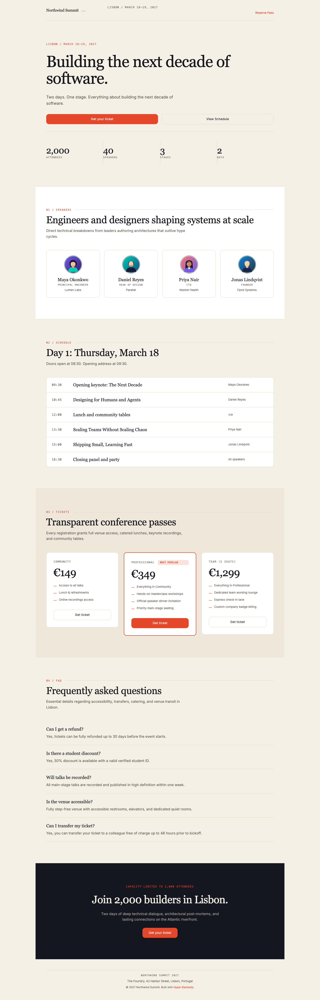
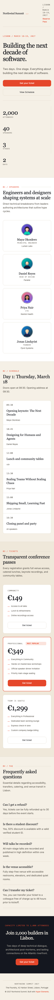
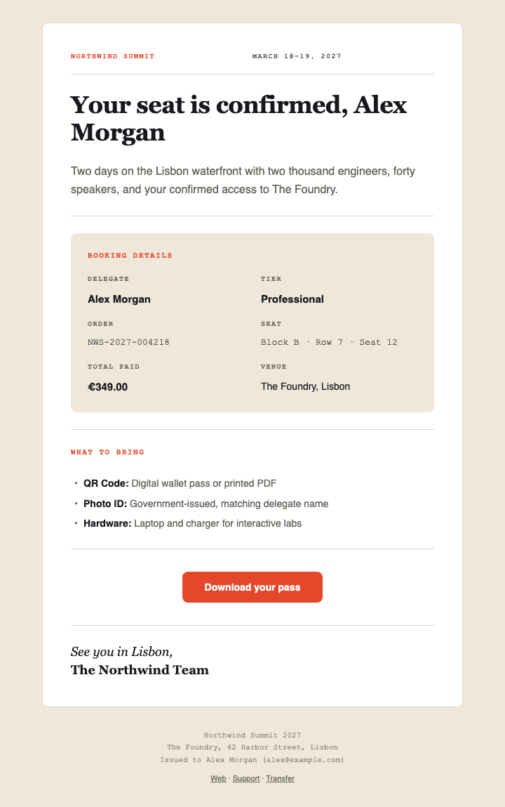
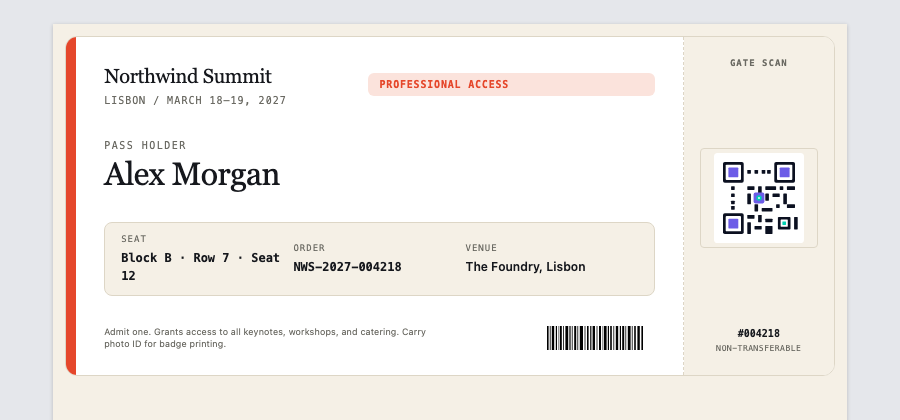
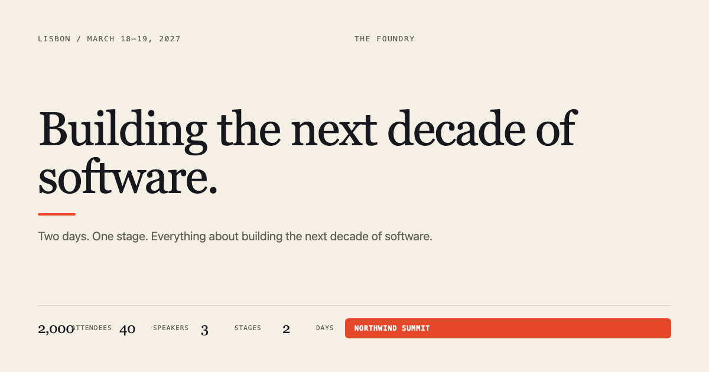
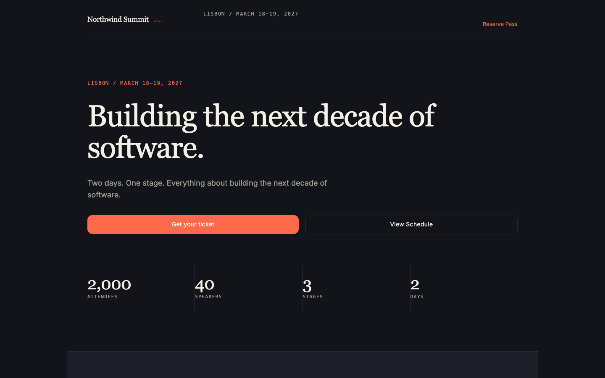

# Northwind Summit 2027 — Launch Kit

> A multi-output template system built with [`@hyper-elements/react`](https://www.hyperelements.dev) for the Hyper Elements Template Challenge.

One design system → four pixel-perfect outputs from shared React components:

| Output | Component | Format |
|--------|-----------|--------|
| Landing Page | `<Page>` | Responsive HTML |
| Confirmation Email | `<Email>` | Email-safe HTML + plain text |
| Event Ticket | `<Document>` | Print HTML + PDF |
| Social Card | `<Canvas>` | HTML + PNG (1200×630) |

## Screenshots

### Launch Kit Overview (Paper Theme)


### Landing Page — Desktop (1440px)


### Landing Page — Mobile (375px)


### Confirmation Email (600px)


### Event Ticket (DL format)


### Social Card (1200×630)


### Ink Theme (Dark)


---

## Design System

### Art Direction: "Modern Editorial"

Printed magazine meets Swiss design — warm paper, confident serif display type, hairline rules, generous whitespace, one sharp accent.

### Palette

| Role | Paper (light) | Ink (dark) |
|------|--------------|------------|
| Background | `#F5F0E6` warm paper | `#12141A` |
| Surface | `#FFFFFF` | `#1B1E27` |
| Text | `#16181D` ink | `#F5F0E6` |
| Muted | `#635F57` | `#A3A194` |
| Border | `#DDD6C6` | `#2C3040` |
| Accent | `#E5472B` vermilion | `#FF6A4D` |

**Rules:** ink + paper + ONE accent. No gradients on text, no drop shadows, no neon. Accent used sparingly: CTA, eyebrow labels, key numbers, highlighted price card.

### Typography

| Role | Family | Details |
|------|--------|---------|
| Display / Headings | **Fraunces** (serif) | weight 500, letter-spacing −0.02em, line-height 1.05 |
| Body / UI | **Inter** (sans-serif) | 16px / 1.6 |
| Labels / Eyebrows | **IBM Plex Mono** | 12px, UPPERCASE, letter-spacing 0.12em |
| Email headings | Georgia | Safe fallback for Fraunces |
| Email body | Helvetica, Arial | Safe fallback for Inter |

### Type Scale

| Level | Desktop | Mobile | Email |
|-------|---------|--------|-------|
| H1 | 72px | 44px | 34px |
| H2 | 44px | 32px | 28px |
| H3 | 22px | — | — |
| Body | 16px | 16px | 16px |

### Spacing

- **Base grid:** 8px
- **Section padding:** 96px desktop / 56px mobile
- **Content max-width:** 1120px
- **Email width:** 600px
- **Card radius:** 12px (consistent everywhere)

---

## Quick Start

```bash
npm install
npm run build          # Paper theme (default)
THEME=ink npm run build  # Ink (dark) theme
npm run typecheck      # TypeScript strict mode
```

### Theme Switching

Set `THEME=ink` environment variable for the dark theme. Default is paper (light).

```bash
THEME=ink npm run build
```

## Project Structure

```
src/
├── themes.ts          # Paper + Ink color palettes, fonts, spacing
├── tokens.ts          # Theme selector (reads THEME env var)
├── data.ts            # Event content (speakers, schedule, pricing, FAQ)
├── build.tsx          # Build pipeline — renders all 4 outputs
├── render-assets.ts   # Playwright screenshots + PDF generation
├── components/        # Shared design system components
│   ├── BrandHeader.tsx
│   ├── CtaButton.tsx
│   ├── SectionTitle.tsx   # "01 / Speakers" numbered headers
│   ├── SpeakerCard.tsx    # Circle avatars, serif names, mono roles
│   ├── ScheduleRow.tsx    # Editorial table rows
│   ├── PriceCard.tsx      # Flat cards with accent highlight
│   ├── InfoBlock.tsx      # Mono-label info pairs
│   ├── FaqItem.tsx        # Hairline-separated Q&A
│   └── Footer.tsx
└── templates/         # Four output templates
    ├── LandingPage.tsx       # <Page> — responsive web
    ├── ConfirmationEmail.tsx  # <Email> — 600px email-safe
    ├── Ticket.tsx            # <Document> — print/PDF
    └── SocialCard.tsx        # <Canvas> — OG image
```

## Built With

- [`@hyper-elements/react`](https://www.hyperelements.dev) v0.4.5
- React 18
- TypeScript (strict mode)
- Playwright (screenshots + PDF)

## License

MIT
