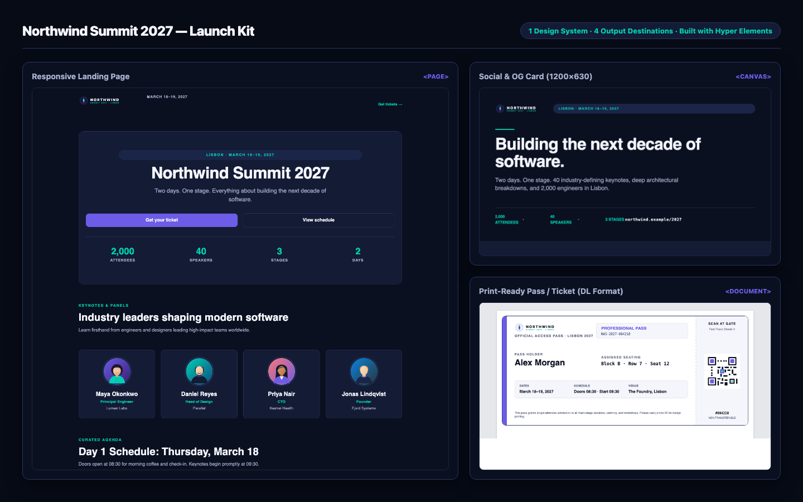
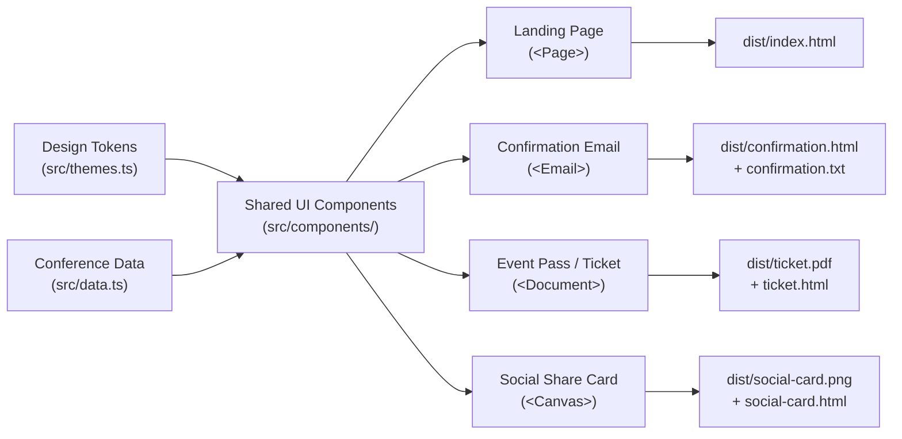

# Northwind Summit Launch Kit

> **One design system. A landing page, an email, a PDF ticket, and a social card — all generated from the same React components.**

Built for the **Hyper Elements Template Challenge** by Unlayer.



[](LICENSE)
[](https://nodejs.org/)
[](https://www.hyperelements.dev)

---

## Preview

The Launch Kit provides a complete, cohesive multi-channel release suite for an international tech conference:

| Deliverable | Root Component | Generated File | Preview |
|---|---|---|---|
| **Responsive Landing Page** | `<Page>` | `dist/index.html` | [View Screenshot](screenshots/landing.png) |
| **Registration Confirmation Email** | `<Email>` | `dist/confirmation.html` + `dist/confirmation.txt` | [View Screenshot](screenshots/email.png) |
| **Print-Ready Admission Ticket** | `<Document>` | `dist/ticket.html` + `dist/ticket.pdf` | [View Screenshot](screenshots/ticket.png) |
| **Social / OpenGraph Card** | `<Canvas>` | `dist/social-card.html` + `dist/social-card.png` | [View Screenshot](screenshots/social-card.png) |

### Daylight Theme Preview
Retheming the entire system requires only a single environment variable:
```bash
THEME=daylight npm run build
```


---

## Hyper Elements Implementation

The Northwind Summit Launch Kit is built from the ground up using **`@hyper-elements/react`**, taking full advantage of its typed primitives and multi-destination rendering engine.

### Architectural Workflow



### Key Library Features Used
1. **Four Unified Roots:** Every template begins with one dedicated root (`<Page>`, `<Email>`, `<Document>`, or `<Canvas>`), each targeting distinct output constraints from the same component hierarchy.
2. **`render()` Multi-Format Output:** Renders responsive web markup for `<Page>`, table-based bulletproof email HTML and plain-text fallback for `<Email>`, paged print markup for `<Document>`, and fixed-dimension layouts for `<Canvas>`.
3. **Shared Design Tokens:** Single source of truth in `src/themes.ts` defining color palettes, spacing scales, border radii, and typographic hierarchies for both **midnight** and **daylight** themes.
4. **Layout Primitives:** Used `<Row>` (with `stackOnMobile`), `<Column>` (for vertical stacks and surfaced cards), `<Grid>` (for equal-width multi-column speaker and pricing grids), and `<Divider>`.
5. **Typed Content Elements:** Strict use of `<Heading>`, `<Text>`, `<Span>`, `<Link>`, `<Button>`, `<List>`, `<ListItem>`, and `<Image>` with explicit width/height dimensions.

---

## Setup Instructions

### Prerequisites
- Node.js 20+
- npm or pnpm

### Quick Start
```bash
# 1. Clone the repository and install dependencies
npm install

# 2. Build all four templates, PDF ticket, social PNG, and screenshots
npm run build

# 3. Preview generated artifacts in your browser
npm run preview
```

### Available Scripts
- `npm run build`: Renders HTML and plain-text templates via `tsx src/build.tsx` and generates PDFs/PNGs via Playwright.
- `npm run build:html`: Fast build producing HTML and plain text files in `dist/`.
- `npm run preview`: Launches a local web server to inspect the `dist/` directory.
- `npm run theme:daylight`: Builds all 4 outputs using the Daylight theme.
- `npm run typecheck`: Runs TypeScript compiler in strict mode (`tsc --noEmit`).

---

## How to Customize

- **Colors & Typography:** Modify `src/themes.ts` to change the palette, fonts, or corner radius.
- **Conference Content:** Update `src/data.ts` to adjust speaker names, sessions, pricing tiers, venue, or FAQs.
- **Assets:** Add custom vector graphics to `assets/` (they are automatically synced to `dist/assets` during build).

---

## Email Client Compatibility Notes
- **File Size:** The generated email HTML is only **16.6 KB** (well within Gmail's 102 KB clipping threshold).
- **Typography:** Uses safe cross-platform system fonts (`Helvetica, Arial, sans-serif`) to prevent font fallbacks or layout shifts in Outlook and Apple Mail.
- **Plain-Text Alternative:** Built-in plain-text output (`dist/confirmation.txt`) ensures accessibility on smart watches and screen readers.

---

## Project Structure

```
northwind-summit-kit/
├── README.md                     # Documentation & preview
├── NOTES.md                      # API cheat sheet & QA checklist log
├── SUBMISSION.md                 # Ready-to-paste contest submission fields
├── LICENSE                       # MIT License
├── package.json                  # Dependencies & npm scripts
├── tsconfig.json                 # TypeScript strict configuration
├── assets/                       # Vector brand assets and avatars
│   ├── logo.svg
│   ├── logo-daylight.svg
│   ├── hero-pattern.svg
│   ├── speaker-1.svg ... speaker-4.svg
│   └── qr-placeholder.svg
├── src/
│   ├── tokens.ts                 # Theme accessor
│   ├── themes.ts                 # Midnight and Daylight theme definitions
│   ├── data.ts                   # Conference data, schedule, speakers, pricing
│   ├── components/               # Shared components across all 4 templates
│   │   ├── BrandHeader.tsx
│   │   ├── CtaButton.tsx
│   │   ├── FaqItem.tsx
│   │   ├── Footer.tsx
│   │   ├── InfoBlock.tsx
│   │   ├── PriceCard.tsx
│   │   ├── ScheduleRow.tsx
│   │   ├── SectionTitle.tsx
│   │   └── SpeakerCard.tsx
│   ├── templates/
│   │   ├── LandingPage.tsx       # <Page> web template
│   │   ├── ConfirmationEmail.tsx # <Email> email template
│   │   ├── Ticket.tsx            # <Document> print ticket
│   │   └── SocialCard.tsx        # <Canvas> 1200x630 OG banner
│   ├── build.tsx                 # Core Hyper Elements rendering pipeline
│   └── render-assets.ts          # Playwright PDF, PNG, and screenshot runner
├── dist/                         # Compiled, runnable deliverables
└── screenshots/                  # Verified preview screenshots
```

---

## License

MIT © 2026. Built for the Hyper Elements Template Challenge.
